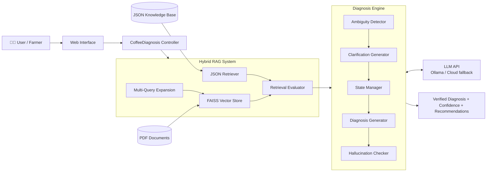

# ☕ Hallucination-Aware Coffee Disease Diagnosis using Hybrid RAG


-orange)


A **hallucination-aware, multi-turn** coffee plant disease diagnosis system built on a **hybrid Retrieval-Augmented Generation (RAG)** pipeline. Instead of guessing from a vague symptom description, the system detects what's missing, asks targeted follow-up questions, retrieves evidence from structured and unstructured sources, and verifies its own answer before replying.

> 📄 Accompanying paper: *Hallucination-Aware Coffee Disease Diagnosis using Retrieval-Augmented Generation*, 7th International Conference on Electrical, Communication and Computer Engineering (ICECCE), 22–23 October 2026, Kuala Lumpur, Malaysia.

---

## 📌 Table of Contents

- [Why this project](#-why-this-project)
- [Key features](#-key-features)
- [Results](#-results)
- [System architecture](#-system-architecture)
- [How it works](#-how-it-works)
- [Example conversation](#-example-conversation)
- [Project structure](#-project-structure)
- [Getting started](#-getting-started)
- [Configuration](#-configuration)
- [Running the app](#-running-the-app)
- [Testing](#-testing)
- [Evaluation dataset](#-evaluation-dataset)
- [Limitations](#-limitations)
- [Future work](#-future-work)
- [Citation](#-citation)
- [Authors](#-authors)
- [References](#-references)

---

## 🌱 Why this project

Farmers rarely describe plant symptoms completely. "Leaves turning yellow" matches many coffee diseases, and a standard RAG chatbot will usually pick one and answer confidently, even when it's wrong. That leads to wrong treatment and lost yield.

This project tackles three failure modes of agricultural diagnosis assistants:

1. **Single-disease retrieval bias**: retrieval collapses onto one disease.
2. **Premature diagnosis**: answering before enough symptom information is available.
3. **Unsupported or inconsistent outputs**: confident answers with no evidence behind them (hallucination).

---

## ✨ Key features

| Feature | What it does |
|---|---|
| 🔍 **Ambiguity detection** | Extracts symptom attributes (location, color, pattern, spread) and finds what's missing before diagnosing. |
| 🗂️ **Hybrid retrieval** | Combines a structured **JSON** disease knowledge base with unstructured **PDF** agronomy references indexed in **FAISS**. |
| ✅ **Retrieval evaluation** | Scores retrieved items (semantic + lexical similarity) and discards low-relevance results. |
| 💬 **Evidence-grounded clarification** | Generates single-focus, jargon-free follow-up questions based on retrieved evidence. |
| 🔁 **Multi-turn state tracking** | Tracks history, candidate diseases, and a confidence score across turns. |
| 🛡️ **Self-consistency verification** | Generates multiple independent diagnoses and checks they agree; disagreement signals possible hallucination. |
| 💻 **Local-first inference** | Runs through an OpenAI-compatible **Ollama** endpoint by default, with optional cloud fallback. |

---

## 📊 Results

Evaluated on **120 manually constructed test cases** across **15 coffee diseases and deficiencies** prevalent in Karnataka.

| Method | Top-1 Acc. (%) | Top-3 Acc. (%) | Hallucination Rate (%) ↓ |
|---|:---:|:---:|:---:|
| Standard RAG (baseline) | 16.67 | 36.67 | 65.55 |
| **Proposed method** | **41.67** | **45.83** | **44.72** |

- **+25.00 percentage points** in Top-1 accuracy.
- **−20.83 percentage points** in hallucination rate (161 unsupported claims out of 360, vs. 236 out of 360 for the baseline).
- **82.53% Semantic Precision@5** for the retrieval component.

**How hallucination was measured:** every test case produces 3 claims (diagnosis, treatment, prevention). A diagnosis is *unsupported* if it doesn't match the ground truth; treatment and prevention claims are *unsupported* if the retrieved evidence for the predicted disease doesn't back them. Rate = unsupported claims / total claims × 100.

---

## 🏗️ System architecture



### Components

- **User interface layer**: farmers describe symptoms in natural language.
- **Knowledge sources**: a curated JSON knowledge base (common names, symptoms, visual patterns, spatial distribution, progression) plus two authoritative PDFs (NIPHM *IPM Package for Coffee* and Vikaspedia *Coffee Cultivation Guide*) embedded into FAISS.
- **Hybrid RAG system**: queries JSON and FAISS in parallel, merges results, and filters out irrelevant content.
- **Diagnosis engine**: Ambiguity Detector, Clarification Generator, State Manager, Diagnosis Generator, and Hallucination Checker.

---

## ⚙️ How it works

### 1. Ambiguity detection
Rule-based parsing with lightweight semantic understanding extracts four attributes from the farmer's input: **location, color, pattern, spread**. Missing attributes are ranked by a predefined priority, with **location first** (it narrows the affected plant organ and eliminates many candidate diseases), then color and pattern, then spread.

### 2. Hybrid knowledge retrieval
Results from both sources are merged with a weighted score:

```
Score(d) = 0.6 × S_JSON(d) + 0.4 × S_PDF(d)
```

- **Structured (JSON)**: matches extracted symptom attributes against disease entries.
- **Unstructured (PDF)**: text chunks embedded with `all-MiniLM-L6-v2` (384-dim) for semantic search in FAISS.

### 3. Retrieval evaluation
Each retrieved item gets a relevance score combining **cosine similarity** (semantic) and **keyword token matching** (lexical). Items below a threshold are dropped.

### 4. Clarification question generation
An LLM generates follow-ups under three constraints: **single-focus** (one missing attribute per question), **evidence-grounded** (uses retrieved context), and **farmer-friendly** language (no scientific jargon).

### 5. Multi-turn interaction and confidence
The State Manager keeps conversation history, retrieved context, candidate diseases, and a confidence score:

```
C = Σ w_a   for a ∈ A (attributes identified so far)
```

| Attribute | Weight |
|---|:---:|
| Location | 0.30 |
| Color | 0.25 |
| Pattern | 0.25 |
| Spread | 0.20 |

The conversation ends when **any** of these is true:
- confidence exceeds the threshold (default **0.7**),
- a single disease remains as the most probable,
- the maximum number of turns is reached.

### 6. Diagnosis generation
The LLM combines retrieved evidence with the conversation history to produce the **disease name**, **treatment steps**, and **preventive measures**.

### 7. Hallucination detection (self-consistency)
The system generates **5 independent outputs** from the same context and compares them. The most frequent diagnosis is selected, and high agreement means the result is reliable; low agreement flags a possible hallucination.

---

## 💬 Example conversation

```
User:    Leaves turning yellow with brown spots
System:  Are the yellow leaves appearing the most on lower leaves, upper leaves,
         or throughout the entire plant?
User:    Mainly on lower leaves
System:  Are the brown spots forming rings, or spreading?
User:    They look like rings
System:  [Diagnosis] Coffee Leaf Rust  + treatment and prevention steps
```

---

## 📁 Project structure

```
agro-veritas-coffee-disease-diagnosis-rag/
├── config/      # Configuration (LLM endpoint, thresholds, limits)
├── data/        # JSON knowledge base and PDF reference documents
├── docs/        # Documentation and paper-related material
├── scripts/     # Utility scripts (indexing, evaluation, etc.)
├── src/         # Core pipeline: retrieval, ambiguity detection, diagnosis, verification
├── test/        # pytest suite and evaluation framework
├── ui/          # Web interface
├── .gitignore
└── README.md
```

---

## 🚀 Getting started

### Prerequisites

- Python 3.10+
- [Ollama](https://ollama.com/) installed and running (for local inference)
- A GPU is optional but helpful. Ollama and the embedding model both use GPU memory, so on small GPUs (e.g. 6 GB VRAM) consider running embeddings on CPU if you hit memory errors.

### Installation

```bash
# 1. Clone
git clone https://github.com/Vishwashgowda/agro-veritas-coffee-disease-diagnosis-rag.git
cd agro-veritas-coffee-disease-diagnosis-rag

# 2. Create a virtual environment
python -m venv venv
source venv/bin/activate        # Windows: venv\Scripts\activate

# 3. Install dependencies
pip install -r requirements.txt

# 4. Pull the local model
ollama pull phi3
```

---

## 🔧 Configuration

Settings live in `config/`. Defaults from the paper:

| Parameter | Value |
|---|---|
| Embedding model | `all-MiniLM-L6-v2` (384-dim) |
| PDF chunk size / overlap | 500 / 50 tokens |
| Retrieval fusion weights | 0.6 JSON / 0.4 PDF |
| Confidence threshold | 0.7 |
| Max clarification turns | 3 (paper setting; adjustable via `MAX_QUESTIONS`) |
| Hallucination-check generations | 5 |
| LLM backend | Ollama `phi3` (3.8B) via OpenAI-compatible endpoint |

Optional cloud fallback can be enabled by setting your provider credentials in a `.env` file:

```env
OLLAMA_BASE_URL=http://localhost:11434/v1
LLM_MODEL=phi3
# Optional cloud fallback
# CLOUD_API_KEY=your_key_here
```

---

## ▶️ Running the app

```bash
# Build the FAISS index from the PDFs (first run only)
python scripts/<index_script>.py

# Launch the web interface
python ui/<app_file>.py
```

---

## 🧪 Testing

```bash
pytest test/ -v
```

---

## 🗃️ Evaluation dataset

- **120 manually constructed test cases** spanning **15 diseases and deficiencies** common in Karnataka.
- Built from the same two reference documents as the knowledge base, with symptom descriptions **paraphrased and made deliberately ambiguous** to resemble real farmer queries.
- Each case has: an initial symptom description, simulated answers to clarification questions, and a ground-truth disease label.
- Multiple scenarios per disease cover variation in symptom expression, completeness, and ambiguity.

---

## ⚠️ Limitations

- **Small, curated evaluation**: 120 cases over 15 diseases; real field conditions may vary more.
- **Static knowledge base**: JSON and PDFs aren't updated automatically with new variants or regional data.
- **LLM dependency**: results come from a lightweight local model (phi3 3.8B); other LLMs will behave differently.
- **No user study**: evaluation is computational; user trust and satisfaction haven't been measured.

> ⚠️ This is a research prototype. It supports decision-making and should not replace advice from an agronomist.

---

## 🔮 Future work

- Expand the disease knowledge base and evaluation set with more diseases and regional variants.
- Collect real farmer feedback to make the evaluation more realistic.
- Adaptive multi-turn strategy that decides the number of clarification rounds based on query complexity.
- Multilingual support (e.g. Kannada) for accessibility.

---

## 📖 Citation

If you use this work, please cite:

```bibtex
@inproceedings{samaga2026coffeerag,
  title     = {Hallucination-Aware Coffee Disease Diagnosis using Retrieval-Augmented Generation},
  author    = {Samaga, Vaidurya and Gowda, Vishwas H and Kusumita, Y and Prajwala, T R and Kasturi, Nivedita and Patil, Swetha},
  booktitle = {Proc. 7th International Conference on Electrical, Communication and Computer Engineering (ICECCE)},
  year      = {2026},
  address   = {Kuala Lumpur, Malaysia}
}
```

---

## 👥 Authors

Department of Computer Science and Engineering, **PES University**, Bengaluru, India.

- Vaidurya Samaga
- Vishwas H Gowda
- Y Kusumita
- Dr. Prajwala T R
- Nivedita Kasturi
- Swetha Patil

---

## 📚 References

Built on ideas from: **CRAG** (Yan et al.), **RAC** (Kebir et al.), **Farmer.Chat** (Singh et al.), and **SelfCheckGPT** (Manakul et al.). Knowledge sources: NIPHM *IPM Package for Coffee* and Vikaspedia *Coffee Cultivation Guide*. See the paper for the full reference list.
